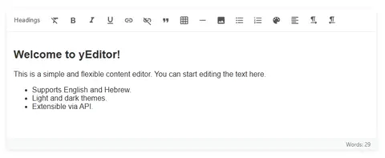

# yEditor - A Simple and Flexible Content Editor

yEditor is an open-source project for creating a JavaScript-based WYSIWYG content editor, designed for easy embedding on any website over a `<textarea>` element. The editor is fully encapsulated using Shadow DOM, supports directionality (RTL/LTR), and offers an API for extensibility.



## Version & CDN Usage

### Using via CDN (Recommended)
```html
<!-- Latest version -->
<script src="https://unpkg.com/yeditor/dist/editor.min.js"></script>

<!-- Specific version -->
<script src="https://unpkg.com/yeditor@v1.0.0/dist/editor.min.js"></script>

<!-- Auto-update: gets latest v1.x.x (patch updates) -->
<script src="https://unpkg.com/yeditor@^1.0.0/dist/editor.min.js"></script>
```

### Using via GitHub Releases
Download specific releases from the [Releases page](https://github.com/yourusername/yeditor/releases).

### Programmatic Version Check
```javascript
console.log(yEditor.version); // e.g., "1.0.0"
```

## Performance & Visual Stability

### Avoiding Flickering (Flash of Un-styled Textarea)

When embedding the editor, the original `<textarea>` may be visible for a brief moment before the editor is fully initialized. To prevent this "flicker" and ensure a smooth user experience, you can hide the textarea using CSS:

```css
/* Hide the textarea until the editor is ready */
.y-editor:not(.yeditor-initialized) {
    visibility: hidden;
    /* Optional: set a height to reserve space and avoid layout shifts */
    height: 300px; 
}
```

The editor will automatically replace the textarea once initialization is complete.

## Key Features

- **Simple Embedding**: Turns any `<textarea>` into a rich content editor with a single line of code.
- **Optimized Loading**: Dependencies and assets (CSS, Lang) are loaded in parallel for maximum performance.
- **Protected Custom Blocks**: Support for non-editable "modules" (shortcodes/embeds) that can be edited via a bubble menu.
- **Multi-language Support**: A JSON-based translation structure allows for easy addition of new languages.
- **Theming**: Built-in support for light and dark themes.
- **Markdown Support**: Automatic conversion of Markdown shortcuts for headings (`## H2`).
- **Extensibility API**: Powerful API to add custom buttons with searchable prompts and multi-selection.

## Installation and Usage

### Local Installation

1.  Download the project files and place the `src` and `dist` directories in your project.
2.  Ensure your HTML page includes the JS file:

    ```html
    <script src="src/editor.js"></script>
    ```

3.  Add a `<textarea>` to your page with a unique `id`.

    ```html
    <textarea id="my-editor" class="y-editor"></textarea>
    ```

4.  Initialize the editor using JavaScript:

    ```javascript
    yEditor.init('#my-editor', {
        lang: 'en',       // e.g., 'en', 'he'
        direction: 'ltr', // 'ltr' or 'rtl'
        theme: 'light',   // 'light' or 'dark'
        height: '400px',  // optional: fixed editor height (e.g., '400px', '50vh', 400)
        maxHeight: '700px', // optional: grow with content up to this height, then scroll internally
        quickLinksApiUrl: '/api/links',  // see Quick Links section below
        imageGalleryApiUrl: '/api/images',
        fileBrowserUrl: '/path/to/your/file-browser.html'
    });
    ```

    **`height`**: By default, the editor grows with its content. Set this option to give the editor a fixed height — the toolbar stays visible at the top and the content area scrolls internally.

    **`maxHeight`**: Keep the flexible behavior, but cap it. The editor grows with its content up to this height; once the content is taller, the editor stops growing and the content area scrolls internally. Useful when you don't want a short article to leave a huge empty editor.

    Both options accept a CSS length (`'700px'`, `'70vh'`, `'calc(100vh - 120px)'`) or a plain number, which is treated as pixels (`height: 700`). If both are set, `height` wins.

### Quick Links (`quickLinksApiUrl`)

When a user types in the link prompt, yEditor sends the search query to your server by appending `?q=<query>` (or `&q=<query>` if your URL already has a `?`).

**Expected API response**: A JSON array of objects with `title` and `url` keys:

```json
[
    { "title": "About Us", "url": "/about" },
    { "title": "Contact",  "url": "/contact" }
]
```

The results are additionally filtered client-side against both `title` and `url`.

### Customizing search results (`renderLinkItem`)

By default each result renders as a clickable row with the title and URL:

```html
<a class="search-result-item" data-url="/about">
    About Us
    <small>/about</small>
</a>
```

Pass a `renderLinkItem(link, query)` function to customize the output. For example, to bold the matching portion of the title and hide the URL:

```javascript
yEditor.init('#my-editor', {
    quickLinksApiUrl: '/api/links',
    renderLinkItem: (link, query) => {
        const q = query.toLowerCase();
        const idx = link.title.toLowerCase().indexOf(q);
        let title = link.title;
        if (idx !== -1) {
            title = title.substring(0, idx) + '<strong>' + title.substring(idx, idx + q.length) + '</strong>' + title.substring(idx + q.length);
        }
        return `<a class="search-result-item" data-url="${link.url}">${title}</a>`;
    }
});
```

### Transforming results (`transformLinkResults`)

Pass a `transformLinkResults(results, query)` function to add, remove, or modify results before they are rendered. Must return an array of `{title, url}` objects.

```javascript
yEditor.init('#my-editor', {
    quickLinksApiUrl: '/api/links',
    transformLinkResults: (links, query) => {
        // Add a "Create new page" entry at the top
        return [
            { title: `+ Create new "${query}" page`, url: `/admin/pages/new?title=${encodeURIComponent(query)}` },
            ...links
        ];
    }
});
```

> Note: `transformLinkResults` runs **before** the client-side filter, so entries you add will also be filtered by the query.

## Code Blocks

Code is treated as a first-class block, not as fragile text:

- Select one line and click the code button to get inline `<code>`; select several lines (or whole blocks) to get a real code block: `<pre><code>...</code></pre>`.
- Clicking the code button with a collapsed caret inserts an empty code block you can type into immediately.
- Press `Enter` on an empty last line to leave the block (one `Shift+Enter` adds an extra empty line). `Backspace` in an empty block removes it.
- Pasting code from an IDE, a chat, a rendered `<pre>`, or a JSON payload is detected automatically and inserted as a code block, byte for byte.
- Code is always displayed left-to-right (also in RTL editors), and code blocks use a dark surface, light text, and a monospace font in both themes. The saved markup stays exactly `<pre><code>...</code></pre>` — no extra attributes or classes are added.

If code blocks on your published site still render right-to-left (because the page is RTL), add this to your site CSS:

```css
pre, pre code {
    direction: ltr;
    text-align: left;
    unicode-bidi: isolate;
}
```

## Extensibility API (Custom Buttons)

You can add custom buttons to the toolbar using the `yEditor.registerButton(config)` function. This is perfect for inserting product modules, shortcodes, or custom UI components.

### Protected Blocks
When a custom button inserts HTML, `yEditor` automatically wraps it in a **Protected Block**. These blocks:
- Are non-editable (`contenteditable="false"`) to prevent accidental corruption.
- Behave as a single unit (deleted with one backspace).
- Show a **Bubble Menu** when clicked, allowing the user to edit the data via the original prompt.

### Example: Multi-Product Shortcode
This example creates a button that allows searching for multiple products and inserting them as a single shortcode like `{products: 1,2,3}`.

```javascript
yEditor.registerButton({
    title: 'Insert Products',
    icon: '<svg>...</svg>', 
    inline: true, // Use a span instead of a div for the block
    
    prompt: {
        title: 'Select Products',
        label: 'Search products:',
        placeholder: 'e.g. iPhone',
        displayField: 'title', 
        multiple: true, // Allow selecting multiple items

        search: async (query) => {
            const response = await fetch(`/api/products?q=${query}`);
            return await response.json();
        },

        renderItem: (item) => `
            <div class="search-result-item" data-item='${JSON.stringify(item)}'>
                <strong>${item.title}</strong>
                <small>${item.price}</small>
            </div>`
    },

    // Generates the HTML stored in the database
    onInsert: (selectedItems) => {
        const ids = selectedItems.map(item => item.id).join(',');
        return `{products: ${ids}}`;
    },

    // Configuration for the "Edit" bubble menu
    edit: {
        selector: '.y-products-shortcode',
        // onOpen can be async to fetch real data from your database
        onOpen: async (element) => {
            // 1. Extract IDs from the shortcode text
            const match = element.textContent.match(/{products: (.*)}/);
            if (!match) return [];
            
            const ids = match[1].split(',').map(id => id.trim());

            try {
                // 2. Fetch actual product names from your API
                const response = await fetch(`/api/products/batch?ids=${ids.join(',')}`);
                if (response.ok) {
                    return await response.json(); // Array of {id, title}
                }
            } catch (e) {
                console.error("Fetch error:", e);
            }

            // Fallback: show placeholders if API fails
            return ids.map(id => ({ id: id, title: `Product ${id}` }));
        }
    }
});
```

## Events API 

yEditor dispatches several custom events on its container element (`.yeditor-container`).

```javascript 
const editorContainer = document.querySelector('.yeditor-container');
editorContainer.addEventListener('yeditor-change', (event) => {
    console.log('New content:', event.detail.content);
});
```

### Available Events
- `yeditor-init`: Fired when the editor is ready.
- `yeditor-change`: Fired on every modification.
- `yeditor-focus` / `yeditor-blur`: Fired on focus changes.
- `yeditor-command-exec`: Fired when a toolbar button is clicked.

## Methods API

#### `yEditor.setContent(selector, content)`
Sets the HTML content of an initialized editor. Content is automatically sanitized while preserving protected block attributes.

#### `yEditor.getInstance(selector)`
Returns the editor instance details (shadowRoot, container, original textarea).

## Acknowledgements

- **DOMPurify**: Robust HTML sanitization.
- **Clarity Icons**: Clean toolbar icons.
- **jsDelivr**: Fast CDN hosting.
